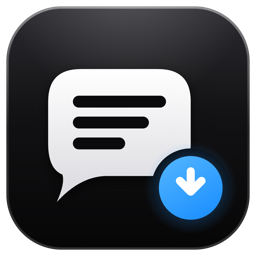
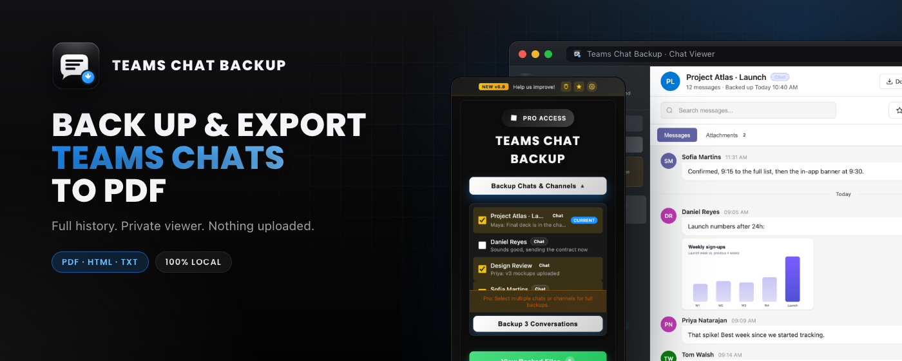

<div align="center">
  

  <h1>Teams Chat Backup</h1>

  <p><strong>Back up and export Microsoft Teams chats and channels to PDF, HTML or TXT.</strong></p>
  <p>A Chrome and Edge extension that reads the chat you have open, saves it in your browser, and gives you a private, searchable viewer. Nothing is uploaded.</p>

  <p>
    <a href="https://github.com/betoxf/teams-chat-backup/actions/workflows/ci.yml"></a>
    <a href="https://chromewebstore.google.com/detail/ijpmkkmgpdjdjpgmochlhadmmdmmncjm"></a>
    
    
    <a href="LICENSE"></a>
  </p>

  <p>
    <a href="#install">Install</a> ·
    <a href="#privacy-at-a-glance">Privacy</a> ·
    <a href="#build-from-source">Build from source</a> ·
    <a href="docs/ARCHITECTURE.md">Architecture</a> ·
    <a href="CHANGELOG.md">Changelog</a> ·
    <a href="CONTRIBUTING.md">Contributing</a> ·
    <a href="SECURITY.md">Security</a> ·
    <a href="https://teamschatbackup.com">Website</a>
  </p>
</div>

<p align="center">
  
</p>

## Why the code is public

Your Teams chats are work conversations. Before you give an extension access to them you should be able to check what it does. This repository is the extension's source, so you, your IT team or a security reviewer can read it, run the tests and load it unpacked.

## What it does

| | |
| --- | --- |
| **Back up** | Scrolls the open chat or channel to the start of its history and reads every message, image, reaction and attachment link. |
| **Export** | Saves PDF, HTML or TXT files. PDFs keep the Teams layout. |
| **Browse** | A Teams-style Chat Viewer with search, jump-to-date, starred messages and a recycle bin. |
| **Move** | Export every backup as one `.zip` and import it on another computer. |
| **Languages** | Works with every Teams display language. The store listing is translated into 25 languages. |

Works on `teams.microsoft.com`, `teams.cloud.microsoft`, `teams.live.com` and Microsoft Defender for Cloud Apps proxies (`*.mcas.ms`).

## Privacy at a glance

| Question | Answer |
| --- | --- |
| Where are my chats stored? | In your browser's IndexedDB, on your computer. There is no backup server. |
| Which pages can it read? | Only the Teams tab you are on, and only after you click the extension (`activeTab`). It has no standing access to any site. |
| Does it send my messages anywhere? | No. Chat content, names and files never leave your browser. |
| What does it contact? | Teams itself (to download images and attachments you already have access to) and, only for Pro activation, RevenueCat with your random License ID. See [SECURITY.md](SECURITY.md). |
| Analytics or tracking? | None. |

## Install

- **Chrome Web Store:** [Teams Chat Backup](https://chromewebstore.google.com/detail/ijpmkkmgpdjdjpgmochlhadmmdmmncjm) (also installs in Microsoft Edge).
- **From source:** see below.

## Build from source

No build step and no dependencies. You need Chrome or Edge, and Node.js 20+ only to run the tests.

```bash
git clone https://github.com/betoxf/teams-chat-backup.git
cd teams-chat-backup
node --test tests/*.mjs
```

Then open `chrome://extensions`, turn on **Developer mode**, click **Load unpacked** and pick the folder. Open a chat in Teams and click the extension.

To make a zip like the one sent to the store:

```bash
node scripts/package-extension.mjs ./teams-chat-backup.zip
```

Builds from source run as the free tier. The store build differs only in two public values filled in at release time: the RevenueCat Web Billing key in `background.js` and the checkout link in `license.js`.

## Project layout

| Path | What it is |
| --- | --- |
| `manifest.json` | Manifest V3 config and permissions |
| `popup.html`, `popup.js`, `popup-brand.css`, `styles.css` | The toolbar popup |
| `content.js` | Injected into the Teams tab: finds the chat, scrolls, reads messages, builds PDFs |
| `background.js` | Service worker: downloads and Pro activation |
| `db.js` | IndexedDB storage for backups |
| `viewer.html`, `viewer.js`, `viewer.css` | The Chat Viewer |
| `license.js` | License ID and checkout link helpers |
| `_locales/` | Store name and summary in 25 languages |
| `libraries/` | Bundled third-party libraries (see below) |
| `tests/` | `node:test` suites |

More detail in [docs/ARCHITECTURE.md](docs/ARCHITECTURE.md).

## License

Source-available under the [PolyForm Noncommercial License 1.0.0](LICENSE). You can read, run, modify and share it for any noncommercial purpose, including personal use and use by charities, schools and public bodies. Selling it or offering it as part of a commercial product needs written permission from Bullfighter Studio.

Bundled libraries keep their own licenses: [jsPDF](https://github.com/parallax/jsPDF) (MIT), [html2canvas](https://github.com/niklasvh/html2canvas) (MIT), [JSZip](https://github.com/Stuk/jszip) (MIT or GPLv3) and [PDFObject](https://github.com/pipwerks/PDFObject) (MIT). The Poppins font is under the SIL Open Font License.

Microsoft Teams is a trademark of Microsoft Corporation. This project is not affiliated with or endorsed by Microsoft.

## Contact

Questions and support: [support@teamschatbackup.com](mailto:support@teamschatbackup.com). Security issues: see [SECURITY.md](SECURITY.md).
